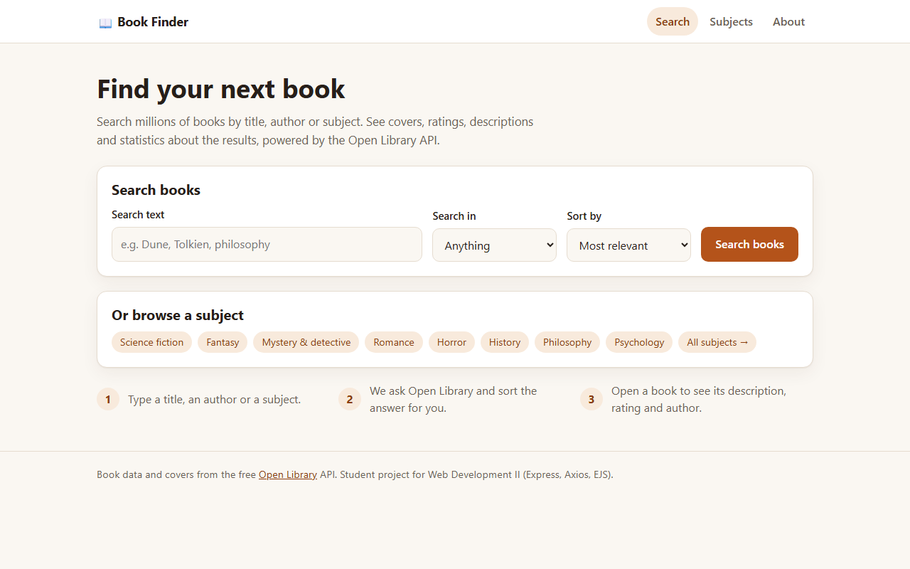
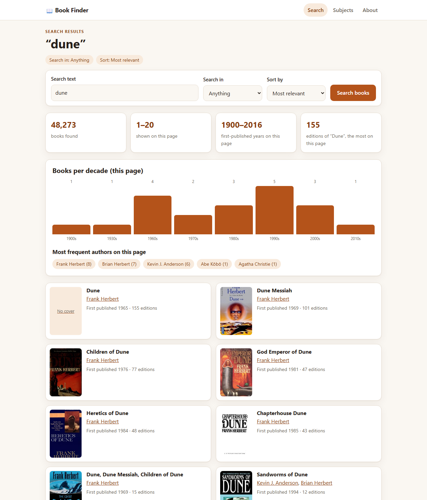
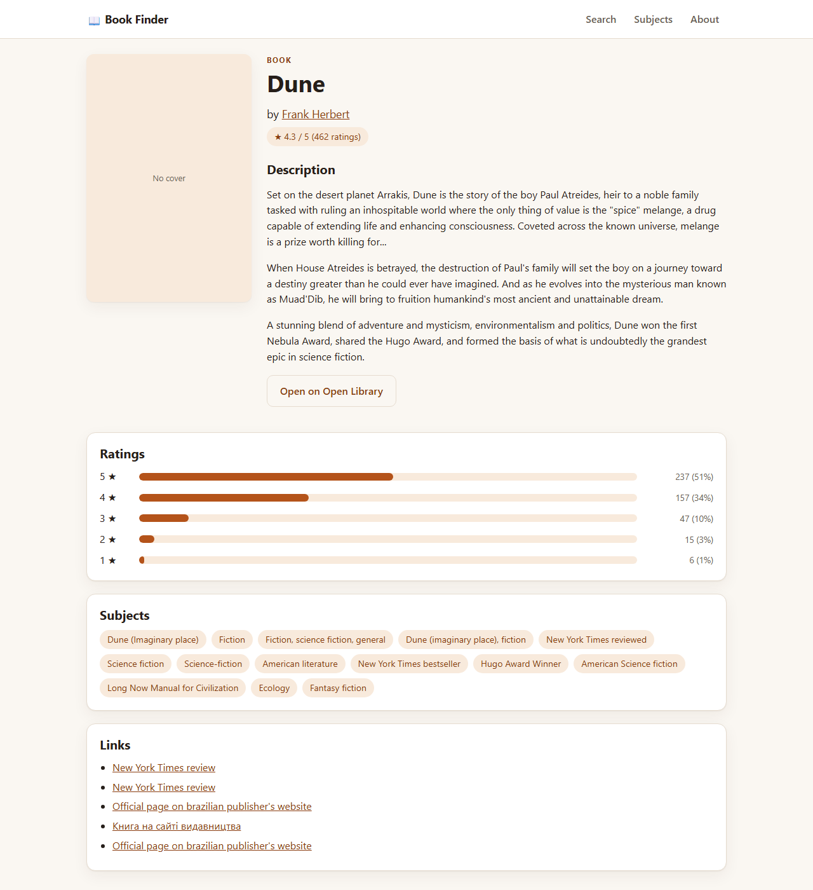
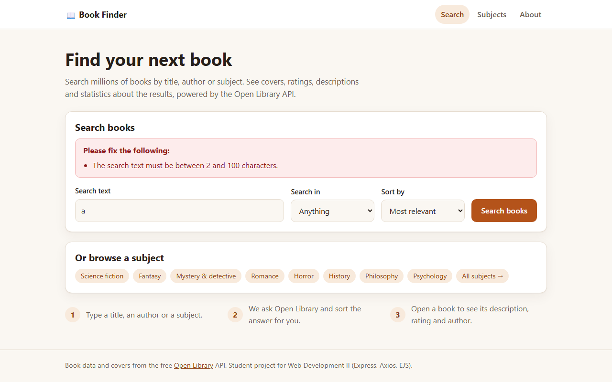

# Book Finder

A small server-side web application to **search books** with the Open Library API. For every
search it shows the number of results, a **books-per-decade chart**, the most frequent authors,
and cards with covers. A book page shows the description, **rating bars**, subjects and links;
author and subject pages list their books.

Built for *Web Development II* (Individual Project) with **Express, Node.js, Axios and EJS**.

## API used

**[Open Library](https://openlibrary.org/developers/api)**: a free public API about books. It needs **no API key**.
It is listed in the [public-apis](https://github.com/public-apis/public-apis) collection (Books).

| Endpoint | Used for |
|---|---|
| `GET /search.json` | search by anything, title, author or subject, with sorting and paging |
| `GET /works/{id}.json` | details of one book |
| `GET /works/{id}/ratings.json` | rating average and the 1-5 star distribution |
| `GET /authors/{id}.json` | author name, dates and biography |
| `GET /authors/{id}/works.json` | books of one author |
| `GET /subjects/{subject}.json` | books of one subject |

Cover images are loaded by the browser from `covers.openlibrary.org`.

## Features

- Search by **anything, title, author or subject**, sorted by relevance, newest or oldest.
- Results page: number of books found, years, the book with the most editions, a CSS bar chart
  of books per decade, the most frequent authors, book cards and pagination (up to 50 pages).
- Book page: cleaned description (Markdown links and reference lists removed), rating average and bars,
  subjects (clickable) and external links.
- Author page: photo, biography and the author's books. Subject page: books, chart and top authors.
- Shareable links, e.g. `/search?q=dune&mode=title&page=2`.
- Server-side validation with friendly messages, a custom 404 page and a central error handler.
- Never crashes on bad input or API failures (timeouts, no connection, rate limit, 4xx/5xx, empty data).
  A failed extra request (authors, ratings) does not break the page; a missing cover becomes a "No cover" box.
- A 10-minute in-memory cache and one automatic retry for the API requests.
- Responsive layout (cards stack on phones) with automatic light/dark theme.

## Routes

| Method | Route | Description |
|---|---|---|
| GET | `/` | Home page with the search form and quick subject links |
| POST | `/search` | Validates the form, calls the API, shows the results |
| GET | `/search?q=&mode=&sort=&page=` | Same results page as a link (pagination, sharing) |
| GET | `/book/:id` | Book details (id like `OL893414W`) |
| GET | `/author/:id` | Author details and books (id like `OL79034A`) |
| GET | `/subjects` | List of quick subjects |
| GET | `/subjects/:name` | Books of one subject (e.g. `science_fiction`) |
| GET | `/about` | About the app and the API |
| any other | | Custom 404 page |

## Project structure (MVC)

```
book-finder/
├── app.js                          # creates the app, registers middleware and routes
├── routes/                         # URL -> controller mapping
├── controllers/                    # request handling logic (validated input -> service -> view)
├── services/openLibraryService.js  # all Axios calls to the external API, cache, retry, error translation
├── middleware/                     # requestLogger, validateSearchForm, validateId, notFound, errorHandler
├── utils/                          # book statistics, text cleaning, AppError, constants
├── views/                          # EJS pages
│   └── partials/                   # header, footer, search form, book card, pagination
├── public/                         # css and client js
├── tests/                          # unit tests (node:test)
├── .env.example
└── package.json
```

## Middleware

- **Built-in:** `express.static`, `express.urlencoded`, `express.json`
- **Custom:** `requestLogger` (time, method, URL, status, duration), `validateSearchForm`
  (checks the search text, mode, sort and page before any API request) and `validateId`
  (checks book, author and subject ids in the URL)
- **404 handler** (`notFound`) and a **centralized error handler** `(err, req, res, next)`

## Installation and run

Requirements: Node.js 18 or newer.

```bash
npm install
cp .env.example .env     # on Windows: copy .env.example .env
npm start
```

Open <http://localhost:3000>.

`.env` settings (all have defaults, the API needs no key):

| Variable | Default | Meaning |
|---|---|---|
| `PORT` | `3000` | port of the web server |
| `OPENLIBRARY_BASE_URL` | `https://openlibrary.org` | API base URL |
| `API_TIMEOUT_MS` | `10000` | how long to wait for the API |

Useful scripts: `npm run dev` (restart on file changes), `npm test` (21 unit tests).

## Screenshots

| Home | Results |
|---|---|
|  |  |

| Book page | Validation message |
|---|---|
|  |  |

## Credits and AI disclosure

- Book data and covers: [Open Library](https://openlibrary.org) (free public API).
- AI assistance (Claude) was used for this project. Details are in the AI Declaration
  submitted in Canvas.
