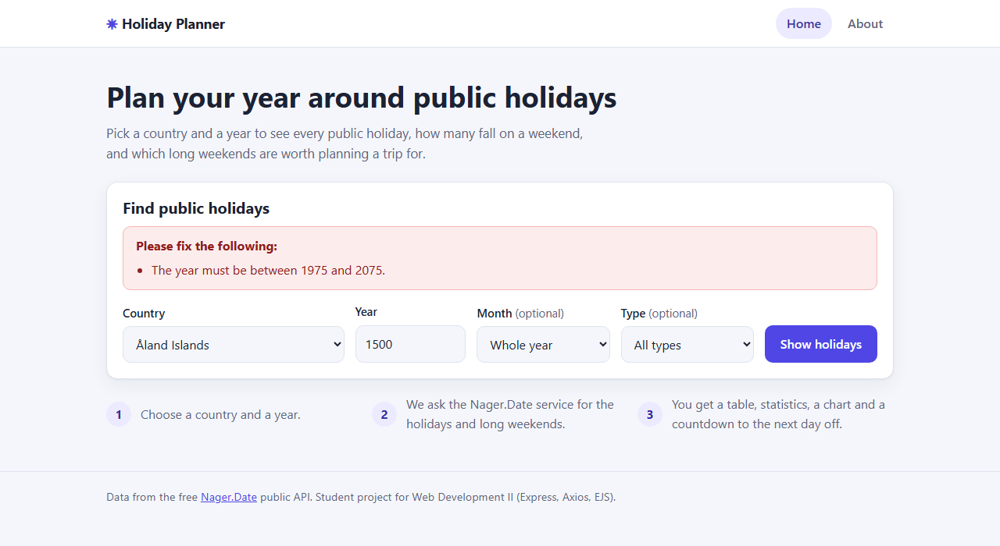
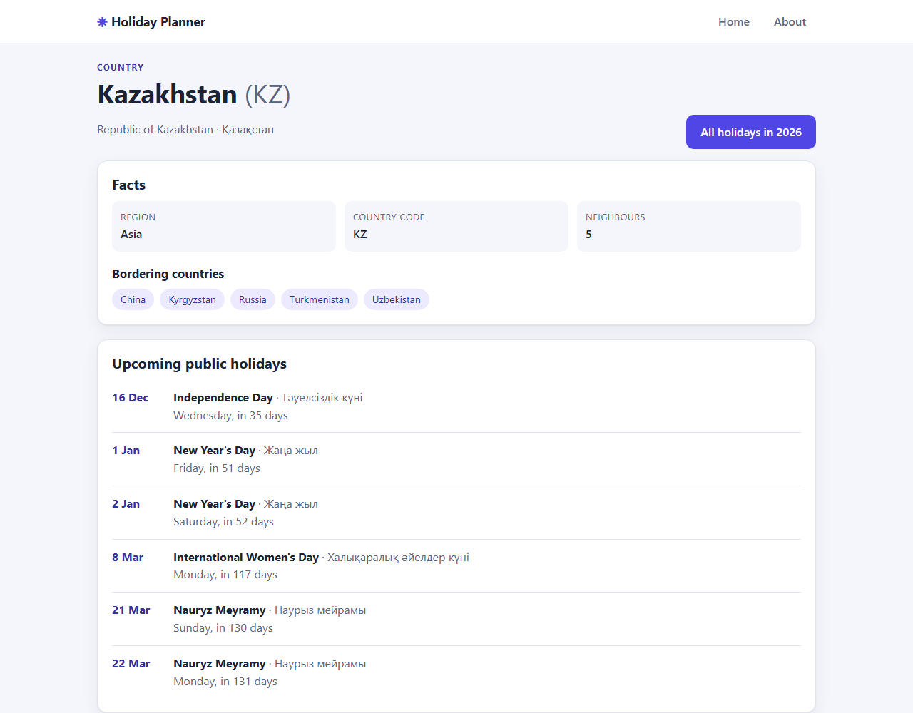

# Holiday Planner

A small server-side web application that shows the **public holidays of any country and year**,
counts how many fall on a weekend, draws a holidays-per-month chart, counts down to the next
day off and lists the **long weekends** worth planning a trip for.

Built for *Web Development II* (Individual Project) with **Express, Node.js, Axios and EJS**.

## API used

**[Nager.Date](https://date.nager.at/Api)**: a free public holiday API. It needs **no API key**.
It is listed in the [public-apis](https://github.com/public-apis/public-apis) collection (Calendar).

| Endpoint | Used for |
|---|---|
| `GET /AvailableCountries` | country drop-down (cached for 1 hour) |
| `GET /PublicHolidays/{year}/{countryCode}` | the holiday table, statistics and chart |
| `GET /LongWeekend/{year}/{countryCode}` | long weekends and bridge days |
| `GET /CountryInfo/{countryCode}` | country page (region, bordering countries) |
| `GET /NextPublicHolidays/{countryCode}` | upcoming holidays on the country page |

## Features

- Search by **country**, **year**, optional **month** and optional **holiday type**.
- Holiday table sorted by date, with weekday, local name, type, scope (nationwide / regional)
  and "in N days / N days ago".
- Statistics: number of holidays, how many fall on a weekend, busiest month, next holiday countdown.
- Pure-CSS bar chart of holidays per month.
- Long weekends with the extra day(s) off needed ("bridge days"); the longest one is highlighted.
- Country page with region, neighbouring countries (clickable) and upcoming holidays.
- Shareable result links, e.g. `/holidays/KZ/2026?month=5`.
- Server-side validation with friendly messages, a custom 404 page and a central error handler.
- Never crashes on bad input or API failures (timeouts, no connection, rate limit, 4xx/5xx, empty data).
- Responsive layout (the table becomes cards on phones) with automatic light/dark theme.

## Routes

| Method | Route | Description |
|---|---|---|
| GET | `/` | Home page with the search form |
| POST | `/holidays` | Validates the form, calls the API, shows the result page |
| GET | `/holidays/:code/:year` | Same result page as a shareable link (`?month=` and `?type=` optional) |
| GET | `/country/:code` | Country details and upcoming holidays |
| GET | `/about` | About the app and the API |
| any other | | Custom 404 page |

## Project structure (MVC)

```
holiday-planner/
├── app.js                       # creates the app, registers middleware and routes
├── routes/                      # URL -> controller mapping
├── controllers/                 # request handling logic (validate result -> service -> view)
├── services/nagerService.js     # all Axios calls to the external API + error translation
├── middleware/                  # requestLogger, validateHolidayForm, notFound, errorHandler
├── utils/                       # dates, holiday statistics, AppError, constants
├── views/                       # EJS pages
│   └── partials/                # header, footer, search form
├── public/                      # css and client js
├── tests/                       # unit tests (node:test)
├── .env.example
└── package.json
```

## Middleware

- **Built-in:** `express.static`, `express.urlencoded`, `express.json`
- **Custom:** `requestLogger` (time, method, URL, status, duration) and `validateHolidayForm`
  (checks country, year, month and type before any API request is made)
- **404 handler** (`notFound`) and a **centralized error handler** `(err, req, res, next)`

## Installation and run

Requirements: Node.js 18 or newer.

```bash
npm install
cp .env.example .env     # on Windows: copy .env.example .env
npm start
```

Open <http://localhost:3000>.

`.env` settings (all have defaults, the API needs no key):

| Variable | Default | Meaning |
|---|---|---|
| `PORT` | `3000` | port of the web server |
| `NAGER_BASE_URL` | `https://date.nager.at/api/v3` | API base URL |
| `API_TIMEOUT_MS` | `8000` | how long to wait for the API |

Useful scripts: `npm run dev` (restart on file changes), `npm test` (unit tests).

## Screenshots

| Home | Results |
|---|---|
|  |  |

| Validation message | Country page |
|---|---|
|  |  |

## Credits and AI disclosure

- Holiday data: [Nager.Date](https://date.nager.at) (free public API).
- AI assistance (Claude) was used for this project. Details are in the AI Declaration
  submitted in Canvas.
